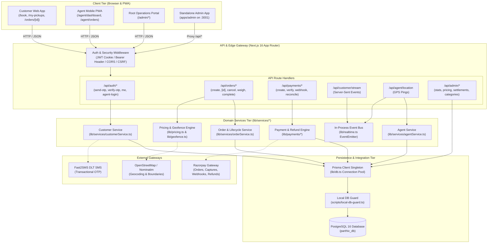
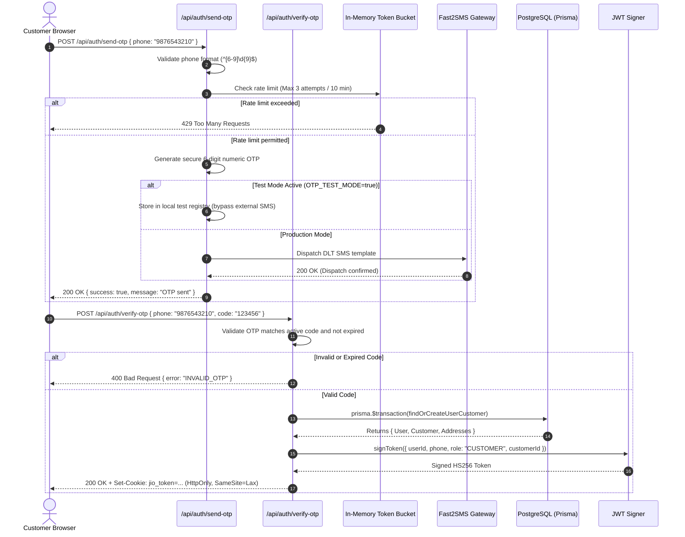
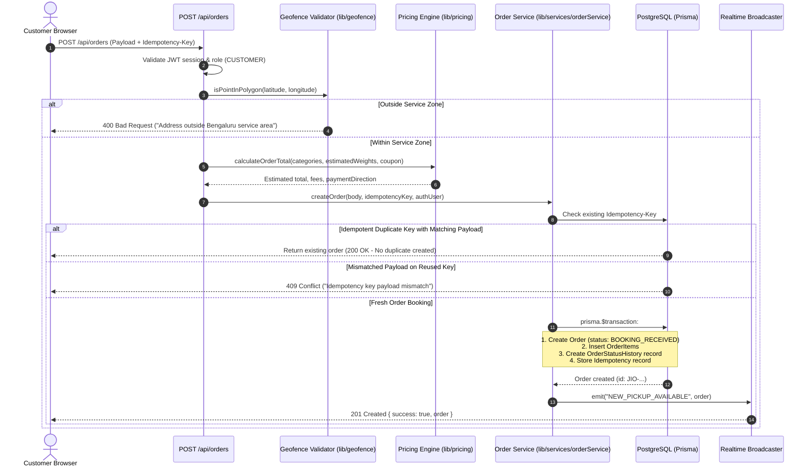
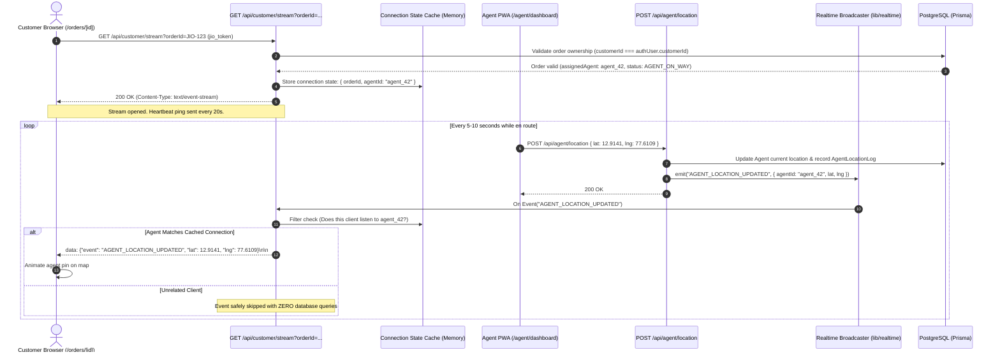
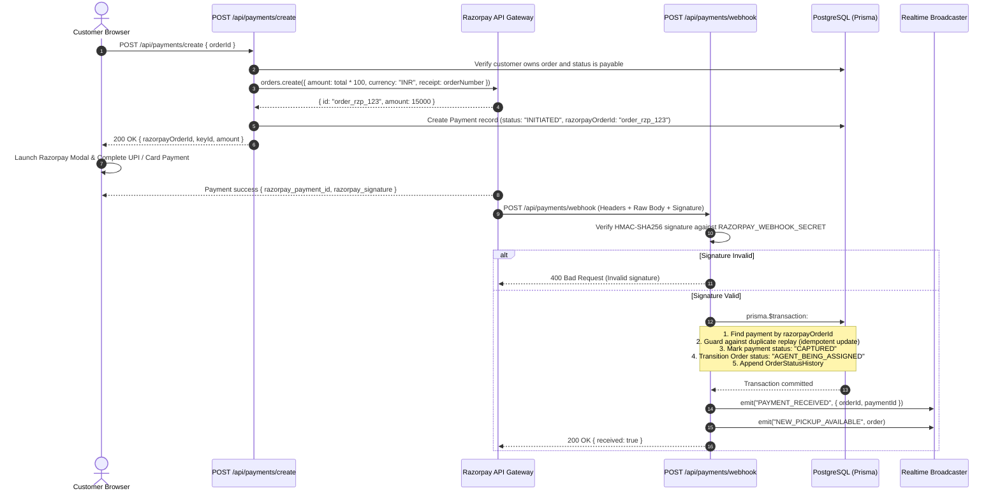
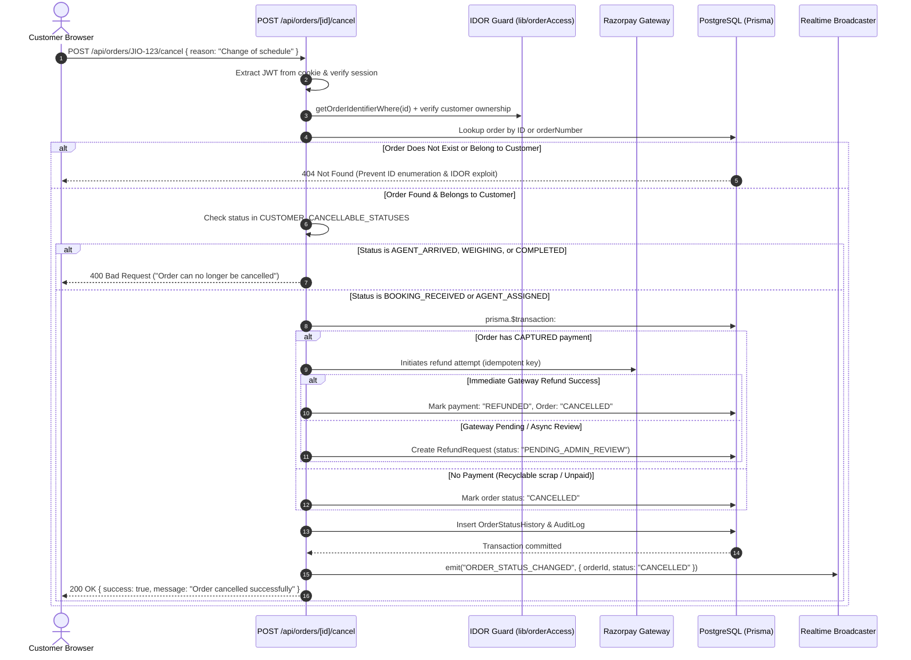

# Junk It Out — Architecture & Data Flow Overview

**Document Version**: 1.0 (Phase 1 Baseline)  
**Date**: October 2026  
**Environment**: Production Ready / Local Development Guarded  
**Stack**: Next.js 16 (App Router), React 19, TypeScript, Prisma 5.22, PostgreSQL 16, Tailwind CSS v4, Vitest  

---

## 1. System Topology Overview

Junk It Out is an on-demand doorstep scrap collection, recycling, and junk removal platform. The system operates across four primary layers:
1. **Client Tier**: Responsive multi-role web applications.
2. **Edge & API Tier**: Next.js App Router route handlers with role-based auth middleware.
3. **Domain Services Tier**: Modular business logic services (`lib/services/*`).
4. **Persistence & Cache Tier**: PostgreSQL via Prisma ORM, local in-memory event buses, and connection-level caches.



---

## 2. Tier Details & Responsibilities

### 2.1 Client Tier
- **Customer Web Interface** (`app/(customer)/*`): Allows waste estimation, recyclable scrap vs bulk junk categorization, slot scheduling, address lookup with geofencing, payment checkout, and live order tracking.
- **Agent Mobile PWA** (`app/agent/*`): Dedicated view for field pickup agents. Receives real-time pickup assignments, handles step-by-step state transitions (`ACCEPT` → `ARRIVE` → `WEIGH` → `COMPLETE`), and streams periodic GPS coordinates.
- **Admin Management Consoles**:
  - **Embedded Admin** (`app/admin/*`): Direct access to operational stats, settlement approvals, pricing updates, and catalog management.
  - **Standalone Admin App** (`apps/admin`): Separate micro-frontend running on port `3001` that proxies API requests to the primary engine while maintaining identical auth and security enforcement.

### 2.2 Edge & API Tier
- **Authentication**: Validates HS256 JWT tokens extracted from either HTTP-only `jio_token` cookies (`SameSite=Lax`, `Secure` in production) or HTTP `Authorization: Bearer <token>` headers.
- **Role Guards**: Four distinct roles: `CUSTOMER`, `AGENT`, `ADMIN`, and `SUPER_ADMIN`.
  - For `AGENT`, the system verifies `tokenVersion` against the database to enable instant session revocation.
  - For `CUSTOMER` and `ADMIN`, cryptographically verified JWT claims provide fast, stateless validation.
- **Safety Guards**: `scripts/local-db-guard.ts` intercepts local developer runtime invocations and prevents accidental connection to remote Supabase or production databases.

### 2.3 Domain Services Tier
- **`orderService.ts`**: Orchestrates order placement, idempotent duplicate prevention, coupon redemption, weight validation, and atomic state transitions.
- **`orderLifecycle.ts`**: Enforces legal state machine transitions (`BOOKING_RECEIVED` → `AGENT_BEING_ASSIGNED` → `AGENT_ASSIGNED` → `AGENT_ACCEPTED` → `AGENT_ON_WAY` → `AGENT_ARRIVED` → `WEIGHING` → `PICKUP_COMPLETED` or `CANCELLED`).
- **`pricingEngine.ts`**: Dynamically calculates whether an order is `JUNKITOUT_PAYS` (for high-value scrap like copper, brass, batteries) or `CUSTOMER_PAYS` (for disposal of bulky furniture, debris, or minimal scrap under the pickup threshold).
- **`realtime.ts`**: In-process pub/sub event bus coordinating live client broadcasts via Server-Sent Events (SSE).

### 2.4 Persistence Tier
- **Prisma Client (`lib/db.ts`)**: Configured with global singleton caching in Node.js to prevent connection pool leaks during Next.js hot module reloading.
- **PostgreSQL Database (`parthiv_db`)**: Relational storage for users, addresses, orders, order items, waste categories, payments, settlements, and immutable audit logs.

---

## 3. Core Request Lifecycles & Sequence Flows

### 3.1 Customer OTP Auth & Session Lifecycle

The OTP authentication flow validates mobile phone numbers, throttles abuse, generates time-limited 6-digit codes, dispatches SMS (or executes local test bypass), verifies the code, and creates or updates the customer record inside an atomic transaction before issuing a JWT session cookie.



---

### 3.2 Waste Pickup Booking & Order Creation

The booking pipeline validates address coordinates against polygon geofencing boundaries, evaluates item prices, calculates financial direction (`CUSTOMER_PAYS` vs `JUNKITOUT_PAYS`), validates idempotency keys, and commits the order atomically.



---

### 3.3 Real-Time Order Tracking via Server-Sent Events (SSE)

Customers track arriving agents via persistent HTTP streaming (`text/event-stream`). High-frequency agent GPS coordinates are broadcast efficiently using connection-level ownership caching to protect the database pool from query amplification.



---

### 3.4 Payment Collection, Webhook Verification & Order Fulfillment

For bulky waste disposal (`CUSTOMER_PAYS`), orders require upfront payment. Payment initiation integrates Razorpay, handles client-side checkout completion, and asynchronously reconciles transactions via cryptographically verified webhooks.



---

### 3.5 Order Cancellation, IDOR Validation & Refund Rollback

Customers can cancel bookings prior to agent arrival. The system strictly defends against Insecure Direct Object Reference (IDOR) attacks, checks status eligibility, rolls back pending states, and triggers automatic refunds or admin review tickets.



---

## 4. UI Testing & Manual Verification Guide

Follow these step-by-step verification procedures in the browser to validate system behavior end-to-end.

### 4.1 Prerequisites
1. Ensure the PostgreSQL local database is running:
   ```powershell
   # Verified running on 127.0.0.1:5433
   ```
2. Start the development server with local database safety guard:
   ```powershell
   npm run dev
   ```
3. Open browser at `http://localhost:3000`.

---

### 4.2 Test Scenario 1: Customer Phone OTP Authentication
1. Navigate to `http://localhost:3000/login`.
2. Enter the local test phone number: `9876543210` (or your configured phone).
3. Click **Send OTP**.
   - **Expected Result**: Success notification displays *"OTP sent successfully"*. (In test mode, console outputs test OTP or `123456`).
4. Enter the 6-digit code `123456` and click **Verify & Continue**.
   - **Expected Result**: Redirects to `/book` or `/my-pickups`. Inspect browser DevTools → Application → Cookies to verify `jio_token` is stored as `HttpOnly`.

---

### 4.3 Test Scenario 2: Waste Pickup Booking & Geofencing
1. Navigate to `http://localhost:3000/book`.
2. **Category Selection**:
   - Select *Paper & Cardboard* (estimated 15 kg).
   - Select *Plastics* (estimated 5 kg).
   - Verify the summary card displays financial direction: *"Junk It Out pays you estimated ₹..."*.
3. **Address & Geofencing**:
   - Set address within South Bengaluru (e.g., *Koramangala 4th Block, Bengaluru*).
   - Select date and time slot.
4. Click **Confirm Booking**.
   - **Expected Result**: Booking is confirmed without errors. Redirects to `/orders/[orderNumber]` or `/my-pickups`. Order status displays `BOOKING_RECEIVED`.

---

### 4.4 Test Scenario 3: Real-Time Order Tracking & SSE Connection
1. Open the created order details page: `http://localhost:3000/orders/[orderNumber]`.
2. Open DevTools → Network tab → Filter by `Fetch/XHR` or `stream`.
3. Locate the request to `/api/customer/stream?orderId=...`:
   - **Headers**: Verify `Content-Type: text/event-stream`.
   - **Status**: `200 OK`.
   - **Messages**: Heartbeat comments `: keepalive` stream every 20 seconds.
4. Simulate agent location updates using an agent session or API call to `/api/agent/location`.
   - **Expected Result**: Tracking pin updates in real-time on the map without full page refresh.

---

### 4.5 Test Scenario 4: Order Cancellation & State Verification
1. From the customer order tracking page (`/orders/[orderNumber]`), click **Cancel Pickup**.
2. Select a cancellation reason (e.g., *"Booked by mistake"*).
3. Confirm the cancellation prompt.
   - **Expected Result**: Status badge immediately updates to `CANCELLED`.
   - Verify refreshing the page maintains the `CANCELLED` status.
   - Verify pickup is updated in `/my-pickups` list.

---

### 4.6 Test Scenario 5: Admin Dashboard & Functional Accuracy
1. Log in with admin credentials or access `http://localhost:3000/admin`.
2. Check the Stats Dashboard:
   - Verify **Total Bookings**, **Active Pickups**, and **Completed Orders** load without console errors.
   - Verify pricing settings under `/admin/pricing` load categories accurately.
3. Verify settlements ledger under `/admin/settlements` loads bounded records without leaking password hashes.

