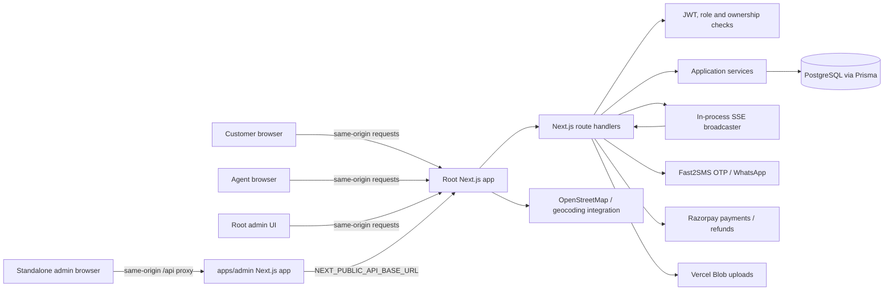
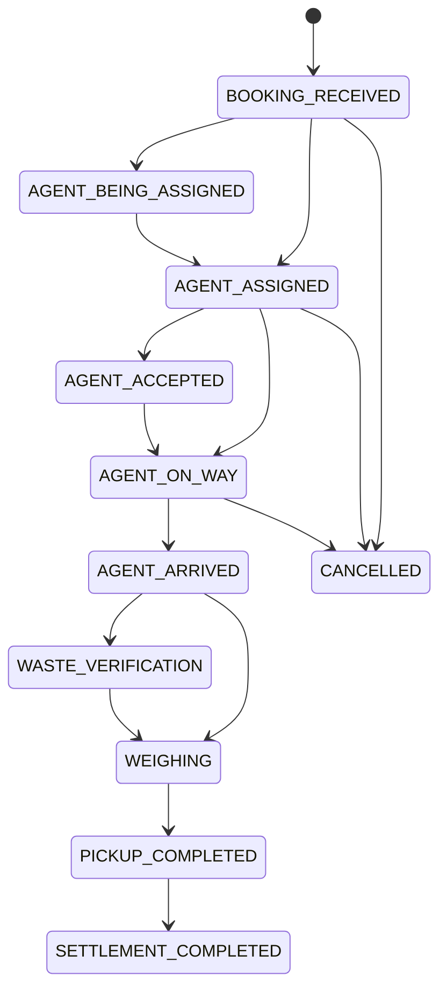
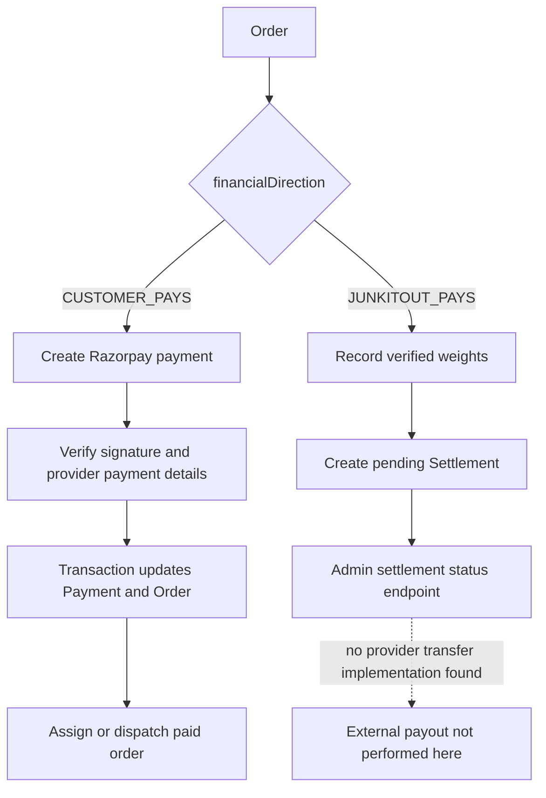

# Junk It Out system design

## Scope and confidence

This describes the checked-out repository as inspected on 2026-10-23. The tree contains substantial pre-existing uncommitted edits, so statements describe the current working copy rather than a clean branch. No production service or database was contacted. Environment files were not read for values. Runtime deployment topology was not verified; only configuration and code paths are described.

## Architecture



The root Next.js application contains customer, agent, and root-hosted admin pages plus backend route handlers. `apps/admin` is a separate Next.js app. Browser requests to its `/api/*` paths go through its catch-all proxy; server-side admin fetches use `NEXT_PUBLIC_API_BASE_URL`. Development URL checks reject a non-loopback admin backend. The root app uses Prisma through `lib/db.ts`; the Prisma datasource names `DATABASE_URL` and `DIRECT_URL`.

### Authentication and boundaries

- Login verifies OTP with Fast2SMS, except the explicitly configured local-only test-phone path which is guarded by `NODE_ENV=development` and `OTP_TEST_MODE=true`.
- The root app signs HS256 JWTs and stores them in an HTTP-only `jio_token` cookie with `SameSite=Lax`; the cookie is marked `Secure` in production. Bearer tokens are also accepted by API auth middleware.
- Route handlers enforce roles and, for customer and agent order operations, query ownership or assignment. The standalone admin proxy forwards the cookie and authorization header; backend authorization remains the boundary.
- Admin and customer JWT claims are not revalidated against the current database role on every request. Agent tokens additionally check `tokenVersion` in the database.
- OTP send/verify throttles are process-local maps. They work within one process but are not a shared, durable limit across restarts or multiple instances.

### Request flows

```mermaid
sequenceDiagram
  participant Customer
  participant Root as Root Next.js API
  participant DB as PostgreSQL/Prisma
  participant RZ as Razorpay
  Customer->>Root: POST /api/orders (JWT, idempotency key)
  Root->>Root: validate role, booking payload and price inputs
  Root->>DB: transaction: idempotency claim, order, items, history
  DB-->>Root: committed order
  Customer->>Root: POST /api/payments/create
  Root->>DB: verify order ownership and amount
  Root->>RZ: create payment order
  RZ-->>Root: provider order reference
  Root->>DB: persist initiated payment and order state
  RZ->>Root: signed webhook or customer verification request
  Root->>RZ: server-side payment verification (verification path)
  Root->>DB: transaction: payment and order state
  Root->>Root: idempotent agent dispatch; failures return a retryable webhook error
  RZ->>Root: duplicate captured event can retry dispatch
```

Webhook capture status is committed before dispatch. A duplicate captured webhook now retries dispatch, and dispatch errors are returned to the webhook caller. Existing customer reconciliation also retries dispatch for an already captured order. This is best-effort recovery, not a durable queue: an outbox is still needed if recovery must not depend on provider retries or a customer request. Refund provider calls still precede local status updates; uncertain outcomes require a durable attempt record and provider-specific reconciliation before any retry.

### Refund workflow

The admin refund route preserves admin authorization and supports the existing full-refund behavior. It compare-and-sets Payment and Order to `REFUND_PROCESSING` and creates a `RefundAttempt` plus `REFUND_REQUESTED` event in one transaction before calling Razorpay. The payment-derived `X-Refund-Idempotency` key and request metadata are stored in event JSON because the existing table has no dedicated key column. Concurrent calls that lose the claim do not issue a provider POST. A pending/in-flight repeat performs only a refund-list lookup and matches the payment ID, full amount, INR currency, provider refund ID, and marker. Reconciliation observations are appended to `RefundAttemptEvent`. Signed refund webhooks persist provider refund IDs and use deterministic event IDs for delivery deduplication; Payment, Order, and attempt status updates are transactional, and terminal success/failure cannot be reverted by delayed events.

Only matching authoritative provider evidence with status `processed` marks the payment/order `REFUNDED`. `pending` stays pending, `failed` stays failed, network timeouts remain in reconciliation, and error-message text never establishes success. The supplied tables have no dedicated idempotency-key or provider-status columns, so those values are stored in sanitized event JSON; `RefundAttempt.paymentId` and `orderId` remain scalar identifiers without database foreign keys, matching the supplied SQL. Partial refunds remain unsupported. If a claim is committed but the request never reaches Razorpay and no provider record appears, the attempt needs manual review; the code deliberately does not blindly POST again. The Prisma models match Kiran's supplied DDL, but no remote schema comparison was run, so database equivalence was not independently verified.





### Order and agent operations

Customer order creation validates input, computes totals server-side, and uses an optional durable idempotency record inside the order transaction. Agent assignment and lifecycle updates use transactions and compare expected order state. Weighing updates order items, history, a weight record, and a pending settlement in one transaction. Agent location is accepted only for an active order assigned to the authenticated agent; duplicate coordinates within 15 seconds do not create another location row. Customer SSE checks order ownership; agent SSE filters by server-derived agent ID; admin SSE emits event names with empty payloads.

### Database relationship summary

- `User` has optional one-to-one `Customer`, `Agent`, or `Admin` profiles and many addresses.
- `Customer` owns orders, idempotency records, complaints, reviews, and settlements.
- `Order` references one customer and address, optionally an agent; it has items, status history, payments, weight records, invoices, notifications, and at most one settlement/idempotency record.
- `OrderItem` references a shared `WasteCategory`; the category carries type and base price.
- `AgentLocation` references an agent and optionally an order. `WeightRecord` references its order and the recording user.
- `Payment` belongs to an order. `Settlement` belongs to an order and customer. `Invoice` and `OrderStatusHistory` belong to an order.
- Most business states are free-form `String` fields rather than Prisma enums. Unique constraints protect user phone/email, order number, settlement-per-order, invoice number, and idempotency key per customer. Explicit indexes include order lookups by customer/createdAt and agent/createdAt; high-volume status and location time-series query indexes should be reviewed with production-like query plans before schema changes.

### Integration and operations boundaries

Fast2SMS is used for OTP and WhatsApp-related notifications. Razorpay is used for customer charges and provider refunds. Upload code supports Vercel Blob when configured/required. Map display uses Leaflet/OpenStreetMap-related code and a geocoding helper. The SSE broadcaster is an in-memory shared `globalThis` singleton per Node process; it is not a cross-process message bus. The current tree includes `.github/workflows/ci.yml`, which validates pull requests and the feature branch; no deployment workflow or hosting manifest is present. The `@vercel/blob` dependency and Vercel-looking admin origin are configuration clues only and do not establish either app's hosting provider. Package scripts are the verified development/build/test entry points.

## API boundaries

See [api-inventory.md](./api-inventory.md) for the route matrix. Customer pages call customer/order/payment/address APIs; the agent UI calls agent/order/location APIs; root and standalone admin UIs call admin routes. Webhooks are provider-to-backend endpoints and must not be called by browsers. The standalone admin proxy is a transport convenience only and does not grant access.
